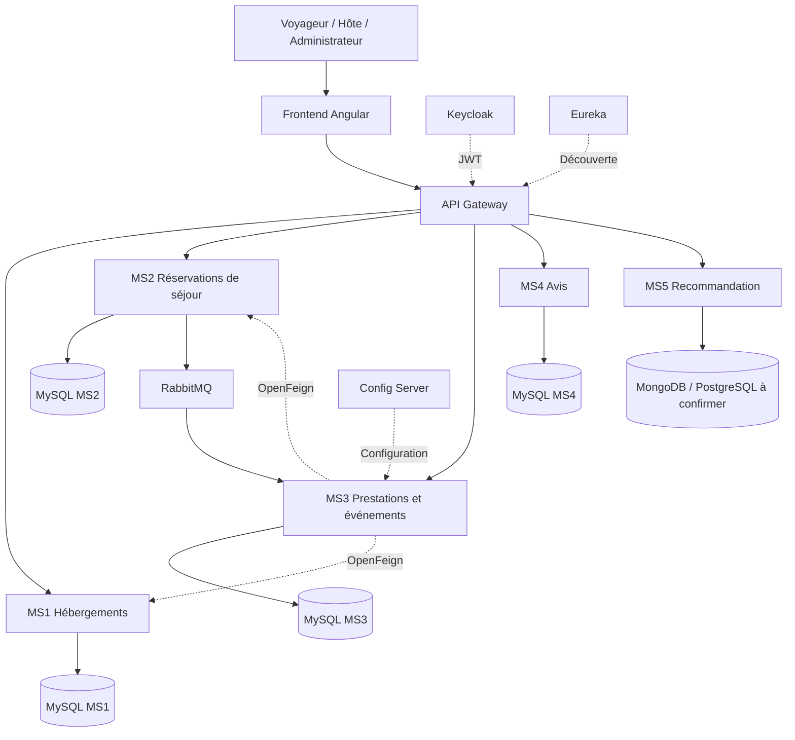

# MarhbaBiik

**Plateforme de réservation de maisons d’hôtes**  
**Projet académique — Architecture Web Distribuée (AWD)**


## 1. Présentation

**MarhbaBiik** est une plateforme web qui met en relation les voyageurs et les propriétaires de maisons d’hôtes. Elle permet de découvrir des hébergements, réserver une chambre ou une maison entière, participer à des activités proposées pendant un séjour, consulter des avis et recevoir des recommandations personnalisées.

### Acteurs

- **Voyageur** : recherche un hébergement, réserve un séjour, s’inscrit à une séance et consulte ses réservations.
- **Hôte / propriétaire** : gère ses hébergements, ses prestations et les séances associées.
- **Administrateur** : supervise les catégories et les opérations autorisées par son rôle.

## 2. Microservices et bases de données

Chaque microservice possède **sa propre base de données** et ne lit pas directement les tables des autres services.

| Microservice | Responsabilité |
|---|---|
| **MS1 — Hébergements** | Gestion des maisons d’hôtes, chambres et informations d’hébergement |
| **MS2 — Réservations de séjour** | Réservation de chambres ou maisons, dates, états et annulations |
| **MS3 — Prestations et événements** | Catégories, prestations, séances, capacités et réservations d’activités |
| **MS4 — Avis** | Notes et commentaires des voyageurs |
| **MS5 — Recommandation intelligente** | Suggestions d’hébergements et d’expériences |


## 3. Technologies et architecture cible

| Technologie | Rôle |
|---|---|
| Angular | Interface web |
| Java / Spring Boot | Développement des API REST |
| Spring Cloud Gateway | Point d’entrée et routage des requêtes |
| Netflix Eureka | Découverte des microservices |
| Spring Cloud Config Server | Centralisation de la configuration |
| Keycloak / JWT | Authentification et gestion des rôles |
| OpenFeign | Appels synchrones entre microservices |
| RabbitMQ | Échange asynchrone d’événements |
| Spring Data JPA / Hibernate | Accès aux bases relationnelles |
| MySQL | Stockage relationnel de MS1 à MS4 |
| Docker / Docker Compose | Conteneurisation et orchestration locale |
| Git / GitHub | Versionnement et collaboration |

### Vue simplifiée



> Le diagramme illustre les interactions principales, et non l’intégralité des dépendances de configuration ou de sécurité.


## 5. Organisation du dépôt

Structure cible à adapter aux dossiers réellement présents :

```text
MarhbaBiik/
├── Backend/
│   ├── ms-hebergements/
│   ├── ms-reservations-sejour/
│   ├── ms-prestations-evenements/
│   ├── ms-avis/
│   ├── ms-recommandation/
│   ├── api-gateway/
│   ├── discovery-server/
│   └── config-server/
├── Frontend/
├── Documentation/
│   ├── Presentation/
│   └── Diagrams/
├── docker-compose.yml          # prévu
└── README.md
```


## 6. Équipe

**Nom d’équipe :** à confirmer  
**Établissement :** ESPRIT  
**Module :** Architecture Web Distribuée (AWD)  
**Année universitaire :** 2026–2027

| Membre | Microservice |
|---|---|
| À Islem Khiari | MS1 — Hébergements |
| À Moataez Guider | MS2 — Réservations de séjour |
| À Yassmine Saidi | MS3 — Prestations et événements |
| À Mariem Samaali | MS4 — Avis |
| Travail collectif | MS5 — Recommandation intelligente |


---

*MarhbaBiik — Un séjour, des rencontres, des expériences.*
